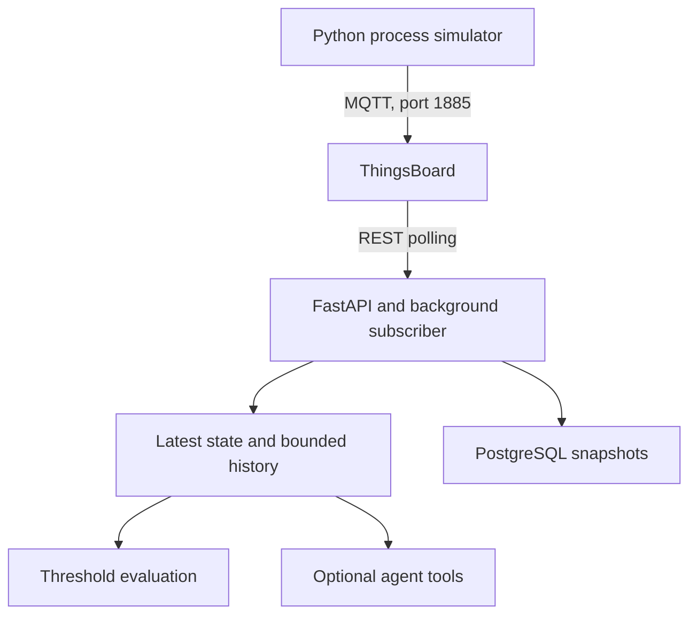

# Timber Digital Twin

**A simulated sawmill telemetry pipeline: generate machine signals, inspect equipment state, and explain threshold alerts.**

This project explores how a timber operation could monitor a saw without connecting to physical equipment. A Python simulator publishes synthetic readings to ThingsBoard over MQTT. A FastAPI backend polls those readings, keeps a short history, attempts PostgreSQL persistence, and evaluates maintenance rules.

**Python · MQTT · ThingsBoard · FastAPI · PostgreSQL · Docker**

[Run the demo](docs/simulacao.md) · [Architecture](docs/arquitetura.md) · [Telemetry and API](docs/protocolos.md) · [Limitations](#current-limitations)

> **Status:** development prototype using synthetic data. It is not a validated physical digital twin or a production maintenance system. Machine-learning files are empty placeholders. The telemetry flow does not require an AI API call.

## What the project demonstrates

| Capability | Implementation | Evaluation opportunity |
| --- | --- | --- |
| Synthetic equipment telemetry | Stateful simulator generates seven readings approximately once per second | Observe changing load, vibration, temperature, and production count |
| IoT ingestion | MQTT publishing to the ThingsBoard device telemetry topic | Trace the boundary between a producer and an IoT platform |
| Current state and recent history | Background REST polling, thread-safe cache, bounded history | Inspect asynchronous ingestion and its consistency trade-offs |
| Maintenance rules | Deterministic thresholds produce OK, WARNING, or CRITICAL | Reproduce boundary cases without an LLM |
| Persistence | PostgreSQL writer inserts timestamped JSONB snapshots | Compare the cache with stored observations |
| Optional operator assistant | Agent tools expose status, history, and alerts to the model | Explore explanations based on tools; correctness is not guaranteed |

**Example question:** Is the simulated saw reporting excessive vibration while running? The deterministic API can expose the triggering value and severity; the optional assistant can describe it in natural language. No actuator commands are implemented.

## Data flow



The main path publishes directly to ThingsBoard. The separate Mosquitto service is not an intermediary in this path. Gazebo assets and Grafana infrastructure exist, but are not a provisioned end-to-end dashboard or sensor integration.

## Start here

Follow the [local demo guide](docs/simulacao.md) to:

1. Start ThingsBoard and PostgreSQL.
2. Create a synthetic device named `serra_01`.
3. Prepare the telemetry table and backend connection.
4. Run `python simulador/process_simulator.py`.
5. Inspect readings through ThingsBoard and the API.

Once the backend and publisher are configured:

```bash
curl http://localhost:8000/health
curl 'http://localhost:8000/status?machine_id=serra_01'
curl 'http://localhost:8000/history?machine_id=serra_01&limit=5'
curl 'http://localhost:8000/alerts?machine_id=serra_01'
```

A representative MQTT message looks like this. These are illustrative values, not a captured run:

```json
{
  "temperature": 82.0,
  "beltSpeed": 1.8,
  "vibration": 4.2,
  "woodCount": 42,
  "status": "running",
  "sawRpm": 3200.0,
  "motorCurrent": 16.0
}
```

At the default thresholds, these readings produce WARNING with TEMPERATURE and VIBRATION alerts. The [contract reference](docs/protocolos.md) explains payloads, endpoints, and threshold boundaries.

## Code walkthrough

| Start with | What to inspect |
| --- | --- |
| [Process simulator](simulador/process_simulator.py) | Stateful random updates and operating ranges |
| [MQTT publisher](simulador/publisher_mqtt.py) | Device-token authentication, payload selection, and QoS 1 |
| [Telemetry subscriber](backend/subscriber/mqtt_subscriber.py) | REST polling, retry behavior, synchronized cache, and database writes |
| [Alert rules](backend/rules/anomaly_rules.py) | Deterministic severity aggregation and configurable thresholds |
| [API](backend/api/main.py) | Lifecycle hooks and status/history/alert endpoints |
| [Agent tools](backend/ai/tools.py) | Shared access to the same cache and rules without internal HTTP calls |

For design choices, component status, and failure behavior, read the [architecture guide](docs/arquitetura.md).

## Verification

The documentation update checked the source and exercised the pure alert rules locally. The [demo guide](docs/simulacao.md#verification) includes repeatable assertions and manual integration criteria.

Docker is unavailable in the documentation-review environment, so container startup, ThingsBoard provisioning, MQTT delivery, PostgreSQL writes, and AI responses have **not** been validated end to end in this update. No latency, accuracy, coverage, or production-use metrics are claimed. Four isolated rule tests pass with `python -m unittest discover -s tests` from the repository root. No CI workflow is included.

## Current limitations

- **Synthetic behavior:** no physical sensor calibration, machine synchronization, or validated predictive model. The script named `mqtt_bridge.py` generates random telemetry; it does not consume Gazebo sensor data.
- **Freshness and completeness:** empty readings yield `health: "UNKNOWN"`; no stale-data alarm exists. `/health` checks API responsiveness only.
- **Storage:** the Compose file does not provision `telemetry_raw`. The demo guide supplies a minimal local schema. Repeated polling can insert duplicate snapshots, and persistence errors do not stop cache updates.
- **Deployment:** dependencies and container images are not fully pinned. Compose contains local demo credentials and exposes services; API routes have no authentication. Use a local, synthetic-data environment.
- **Integration:** no provisioned Grafana dashboard, full Gazebo telemetry bridge, or completed ML implementation is included.
- **Secrets:** a previously committed AI credential was removed from the current Compose configuration. Repository history still requires remediation, and the exposed credential must be revoked by its owner.

## Next milestones

1. Add freshness checks, explicit missing-data status, and telemetry schema validation.
2. Add database migrations, deduplication, and integration tests for persistence.
3. Pin a verified dependency/image set and provision a reproducible dashboard.
4. Connect actual Gazebo sensors before claiming physics-driven telemetry.
5. Evaluate ML only after establishing a dataset, baseline, and validation method.

## Maintainer

[João Vitor Messias da Cruz Damasio](https://github.com/joaovitormessias)

Questions and reproducible bugs can be reported in [Issues](https://github.com/joaovitormessias/digital-twin-for-a-timber-company/issues). No license file is currently included.
